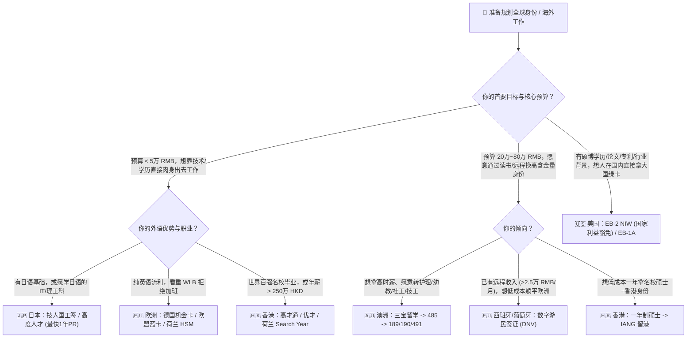

# 🌍 Get_PR：全球主流身份、工签与技术移民 DIY 实战手册

  
  
  
  

> **拒绝数万元黑心中介“信息差税”，用工程化思维拆解全球主流国家/地区合法签证、工作与永居（PR）路径。**  
> 本仓库专注于 **澳大利亚 🇦🇺、日本 🇯🇵、美国 🇺🇸、中国香港 🇭🇰、欧洲（德/荷/葡等）🇪🇺** 五大高热度目的地，不仅讲**“怎么出去”**，更讲透**“花多少钱、怎么续签、怎么避坑、怎么稳拿永居”**。

---

## 💡 为什么建立这个仓库？

GitHub 上已有不少“润学”仓库，但大多数停留在几年前的零散经验贴，缺乏对**最新政策变动、真实获邀分数线、续签死穴以及隐性资金成本**的量化分析。

本仓库坚持三个原则：
1. **数据与官信源驱动（Source of Truth）**：所有门槛、打分表、薪资线均对齐各国移民局最新官方条款。
2. **全链路闭环（Entry to PR）**：拒绝“只管下签不管死活”的中介话术，重点剖析**续签卡点**与**转永居确定性**。
3. **100% DIY 友好**：绝大部分技术移民、人才引进、留学工签完全可以独立 DIY。
   * 🛠️ **配套自动化工具**：如果你不想手动比对几十页官方 Checklist、算分表或从零撰写英文/日文文书，可以使用本仓库配套的智能签证与全球流动助手 **[VisaDuo](https://visaduo.com)** 进行多国打分评估、个性化材料清单生成、AI 申请文书辅助与进度追踪。

---

## 📊 五大目的地核心路径全景对比表 (2026 最新版)

| 目的地 | 核心路径 | 适合人群 | 启动资金估算 (RMB) | 语言硬门槛 | 拿永居 (PR) 周期 | PR 确定性 | 致命雷区 / 核心卡点 |
| :--- | :--- | :--- | :--- | :--- | :--- | :--- | :--- |
| **🇦🇺 澳洲** | **189 / 190 / 491 技术移民** | 医疗/护理/幼教/社工/建筑、极高分 IT/工程 | 3万~5万 (纯海外DIY) 50万~80万 (留学路径) | 雅思 4个7 起步 (热门职业需 4个8) | 获邀即 PR (189/190) 491 需偏远地区满 3 年 | ⭐⭐⭐ (三宝高) ⭐ (离岸IT极难) | 职业评估卡工作年限；485 工签年龄上限降至 35 岁；EOI 极度内卷 |
| **🇦🇺 澳洲** | **482 (SID) 雇主担保 -> 186** | 有海外名企/扎实工作经验、能找到澳洲雇主者 | 2万~4万 (个人签证费) | 雅思 4个5 ~ 4个6 | 2~3 年转 186 PR | ⭐⭐⭐⭐ | 真实雇主难找；千万别买高价虚假雇主担保（严打且易人财两空） |
| **🇯🇵 日本** | **高度人才签证 (HSP 1号/2号)** | 本硕以上、IT/金融/研发、有一定年薪或名校背景 | 2万~5万 (直聘) 15万~25万 (语校/修士过渡) | IT岗可英语/N2； N1 加 15 分极关键 | **最快 1 年** (80分+) 或 **3 年** (70分+) | ⭐⭐⭐⭐⭐ | 华人黑心派遣 (SES) 待机费坑；永住审查对社保/纳税按时缴纳极严 |
| **🇯🇵 日本** | **技术·人文知识·国际业务 / J-Find** | 普通本科/大专+工作经验，或全球百强名校毕业生 | 1万~3万 (直聘) 8万~12万 (J-Find 找工作) | 建议 N2 以上 | 住满 10 年 (工作满 5 年) 期间可凑分转高度人才 | ⭐⭐⭐⭐ | 薪资天花板受日元汇率影响；需警惕空壳公司经营管理签续签暴雷 |
| **🇺🇸 美国** | **EB-2 NIW (国家利益豁免)** | 硕士以上、科研人员、有论文/专利/行业影响力的工程师 | 4万~8万 (DIY+官费) 10万~15万 (律所) | 无硬性语言要求 | 排期约 3.5~5 年 | ⭐⭐⭐⭐ | 无需雇主担保，但 STEM/商业类 RFE (补件) 率上升，需强有力论证报告 |
| **🇺🇸 美国** | **EB-1A (杰出人才) / O-1** | 行业顶尖专家、高管、大厂核心架构/AI研究员、艺术家 | 5万~10万 (DIY) 15万~30万 (律所) | 无硬性语言要求 | EB-1A 排期约 2~3 年 O-1 为非移民工签 | ⭐⭐⭐⭐ | 严查流水线水奖/水论文包装；主张 Original Contribution 需铁证 |
| **🇺🇸 美国** | **L-1A / L-1B (跨国高管/专家)** | 在外企中国分部工作满 1 年，支持内部 Transfer 者 | 0 元 (公司全包) | 业务流利英语 | L-1A 转 EB-1C 约 2~3 年 | ⭐⭐⭐⭐ | 强绑定雇主；L-1B 仍需走 PERM 劳工证转 EB-2/3，排期长 |
| **🇭🇰 香港** | **高才通计划 (TTPS A/B/C类)** | 年薪 ≥ 250万港币 (A类)，或全球百强名校学士 (B/C类) | 1万以内 (签证+激活) 续签维护成本视在港情况 | 无硬性要求 (在港工作需粤语/英语) | 连续通常居住满 **7 年** | ⭐⭐⭐ (下签极快，**续签极严**) | **只能获批一次**；满 2/3 年续签严查真实在港受雇或实质商业运营 |
| **🇭🇰 香港** | **优才计划 (QMAS 新版 12 项准则)** | 满足 12 项评核准则中至少 6 项的精英人才 | 1万以内 | 需具备良好中/英文 | 满 7 年转永居 | ⭐⭐⭐ | 告别旧版凑分制，门槛大幅提高；同样面临第 3 年续签与通常居住核查 |
| **🇭🇰 香港** | **留学进修 (1年硕士) -> IANG** | 本科背景普通、想补学历同时拿香港身份者 | 25万~45万 (学费+1年生活费) | 雅思 6.0~6.5 (部分中文专业免雅思) | 读书 1 年 + 工作 6 年 = 7 年 | ⭐⭐⭐⭐ | 中文水硕竞争激烈；毕业后需在港找到匹配薪资的工作以维持 IANG 续签 |
| **🇪🇺 欧洲** | **德国机会卡 (Chancenkarte) & 欧盟蓝卡** | 本科/技校学历、IT/工程/紧缺行业、向往 WLB 者 | 10万 RMB 冻结保证金 (机会卡) 蓝卡有 Offer 仅需数千元 | 机会卡：英语 B2 或德语 A1 蓝卡：看雇主 (IT多用英语) | **最快 21 个月** (德语 B1) 或 **27 个月** (德语 A1) | ⭐⭐⭐⭐⭐ | 纯英语在德找工作竞争加剧；高税收高福利，不适合追求暴富人群 |
| **🇪🇺 欧洲** | **荷兰高技术移民 (HSM) / Search Year** | 全球前 200 名校硕博 (Search Year)，或拿到荷企 Offer 者 | 8万~12万 (找工作年生活费) | 英语极佳 (全欧英语普及率最高) | 住满 5 年 (需通过荷兰语 A2/B1 融入考试) | ⭐⭐⭐⭐ | 30% Ruling (免税福利) 政策缩水；阿姆斯特丹等城市租房地狱级难度 |
| **🇪🇺 欧洲** | **西班牙 / 葡萄牙 数字游民签证 (DNV)** | 有稳定海外远程工作/自由职业收入者 (约 €2,600~€3,500/月) | 5万~10万 (存款证明+安家) | 英语即可，入籍需西语 A2 / 葡语 A2 | 住满 5 年申请永居/入籍 | ⭐⭐⭐⭐ | 需证明远程合同合规及社保/税务衔接；不可在当地直接跟本地人抢工作 |

---

## 📂 仓库目录导航

### 1. 各国/地区深度 DIY 指南（含官方算分表、费用明细与续签避坑）
* 🇦🇺 **[01-澳大利亚：189/190/491 技术移民、三宝留学与 482 雇主担保全解](./docs/01-australia/README.md)**
* 🇯🇵 **[02-日本：高度人才 1 年永住算分、技人国直聘、J-Find 与语校避坑指南](./docs/02-japan/README.md)**
* 🇺🇸 **[03-美国：EB-2 NIW / EB-1A 独立 DIY、L-1 内部转岗与 F-1/H-1B 破局](./docs/03-usa/README.md)**
* 🇭🇰 **[04-中国香港：高才通、新版优才 12 选 6、IANG 留学及“7年续签保卫战”](./docs/04-hongkong/README.md)**
* 🇪🇺 **[05-欧洲：德国机会卡/蓝卡、荷兰 HSM/Search Year 与南欧数字游民签证](./docs/05-europe/README.md)**

### 2. 实用 DIY 模板与算账工具
* 📋 **[通用 DIY 申请材料总表与中英日文书 Checklist](./templates/diy-checklist-and-sop.md)**

---

## 🧭 30 秒自我定位：我到底该看哪一篇？

> 🔗 **拿不准自己能凑多少分？**  
> 访问 **[VisaDuo 智能评估引擎 (visaduo.com)](https://visaduo.com)**，输入你的年龄、学历、语言和预算，30 秒自动比对全球 50+ 条主流签证路径，生成专属 **《DIY 可行性报告 + 申请材料清单》**。

---

## 🤝 贡献与免责声明 (Disclaimer)

1. **非法律建议**：本仓库所有内容均整理自各国移民局公开政策与社区真实 DIY 案例，仅供信息参考，不构成任何正式移民法律意见。
2. **欢迎 PR**：移民政策瞬息万变，如果你发现某项打分标准、薪资线或排期有更新，欢迎提交 Issue 或 Pull Request！
3. **Star 支持**：如果本仓库帮你省下了几万块中介费，请点亮右上角的 ⭐ **Star**，让更多 DIY 申请者看到！
